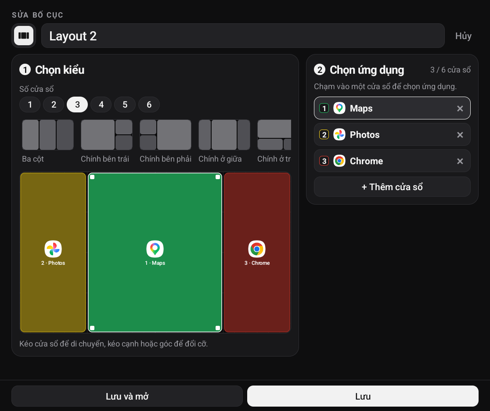
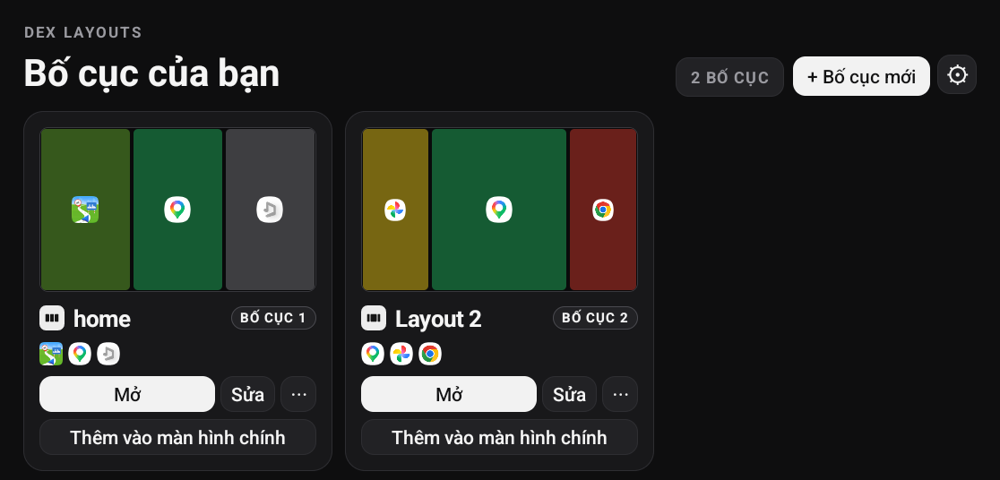
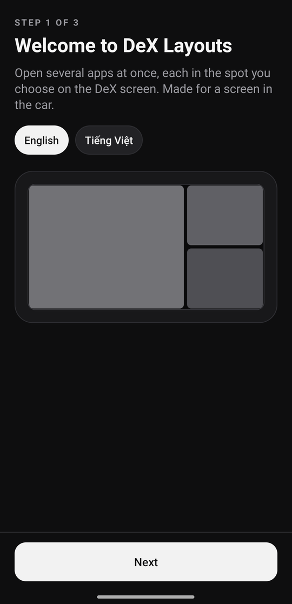
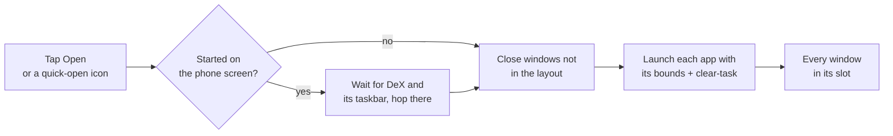

# DeX Layouts

**One tap, every app in its place.**
Save window layouts for Samsung DeX and open them in one go: each app lands exactly where
you put it, and everything else gets out of the way. Built for the DeX screen in my car.

 

-1B1B1F?style=flat-square&logo=android)

> [!NOTE]
> This repo holds the **release builds** and this page. The app's source code is private.
> Screenshots are from my own phone; the DeX shots show the app's Vietnamese UI (English is the default).

The editor on DeX: pick a shape, drag windows on a 24 × 16 grid, choose an app for each.

<table>
<tr>
<td width="62%" align="center"> <b>Your layouts, ready to open</b></td>
<td width="38%" align="center"> <b>Three-step setup</b></td>
</tr>
</table>

 

## ✨ What you get

- 🪟 **Layouts of up to 6 windows**, from 20 preset shapes or your own, on a 24 × 16 grid
- ⚡ **Open in one tap**: every app opens at its exact size and position on the DeX screen
- 🧹 **Only the layout stays**: windows that aren't part of it are closed first
- 🔁 **Apps already open move into place** instead of staying where the last layout put them
- 📌 **Quick-open icons** (*Layout 1–5*) to pin to the taskbar or start from **Bixby Routines**, e.g. when the phone connects to the car
- 🌐 **English and Tiếng Việt**

 

## 🛠️ How a layout opens

DeX gives apps no way to move another app's window, so each step works around a platform limit:

- **Exact bounds.** Each app is started with launch bounds computed from the grid and the space
  above the DeX taskbar. When a Bixby Routine fires before the taskbar has finished appearing, the app
  waits for it, so windows don't end up underneath.
- **Moving apps that are already open.** Android ignores launch bounds for a window that already
  exists and just brings it to the front. Relaunching with *clear-task* reopens it in the new slot.
- **Closing the rest.** An optional accessibility service taps the **X** on each other window's title
  bar. DeX ignores that X while a window is covered by another, so each one is brought to the front
  before it's closed.
- **Staying alive.** DeX restarts an app when it moves between the phone screen and the DeX screen,
  which would stop the service every time a routine started on the phone. Samsung's keep-alive flags
  prevent that.

Apps that declare a fixed size (some car apps do) always get DeX's phone-sized window, whatever
the layout says.

 

## 📥 Install

1. On a Samsung phone with DeX (Android 11 or later), download **DeX-Layouts-1.0.apk** from the
   [latest release](https://github.com/baotrq/dex-layouts-releases/releases/latest) and open it.
   Allow installing from that source if Android asks.
2. Open **DeX Layouts** and follow the three-step setup.
3. Turn on Accessibility for **DeX Layouts: close other apps** (Settings › Accessibility ›
   Installed apps). If the switch is greyed out: Settings › Apps › DeX Layouts › ⋮ ›
   *Allow restricted settings*, then try again.

> [!IMPORTANT]
> The accessibility service is used only to find and tap the close button of DeX windows that
> aren't part of the layout you open. It reads nothing else on screen and sends nothing anywhere;
> the app has no internet permission.

 

## ☕ Support

The app is free and works fully without paying. If it helps you, you can buy me a coffee:

VietQR · MB Bank · 388388338888 · TRUONG GIA BAO

